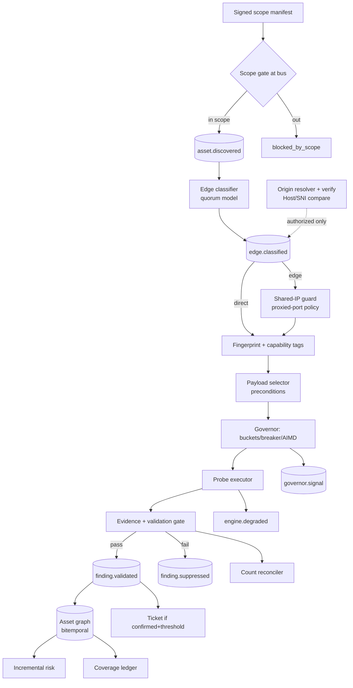

# ARCHITECTURE — edge-context pipeline (edgetask.md §2, PLT-04)

The edge/CDN-aware scanning pipeline sits between the scope manifest and the
existing scan engine. Components own exactly one concern; everything else is
someone else's job.

## Pipeline

## Component responsibility matrix (§2.1)

| Component | Owns | Must never |
|---|---|---|
| Scope gate | admission | touch network |
| Edge classifier | vendor + confidence | classify on one weak signal |
| Shared-IP guard | port policy on edge | port-scan beyond manifest |
| Fingerprint | tags + confidence | assert origin from edge data |
| Payload selector | probe choice | fuzz without preconditions |
| Governor | rate/backoff | crash the run |
| Validator | evidence gate | promote heuristics |
| Reconciler | count truth | let deltas go unexplained |
| Coverage ledger | honest state | call degraded "clean" |

## Implementation map (this repo)

| edgetask component | Code |
|---|---|
| Scope gate / manifest (§1.1) | `src/edgectx/manifest.ts` — `manifestValid`, `assetInScope`, `portPermitted`, `applySharedIpGuard` |
| Edge classifier (EDGE-01, §8.1) | `src/edgectx/classifier.ts` — `classify` quorum, `VENDOR_PACKS` (5 vendors), `cidrContains` IP-range feed |
| Shared-IP guard (EDGE-04, §1.2) | `applySharedIpGuard` — manifest port subset on edge IPs; (hostname, vantage) attribution |
| Vantage/surface (EDGE-03, §1.3) | `Finding.surface`; orchestrator stamps `surface='edge'` when the edge verdict is not none; ORIG-04 gap note on every category |
| Degradation (§1.4, HON-01) | `EngineRunResult.degraded`; asset-discovery sets it on resolver/CT/whois failure; coverage maps to `NOT_EXECUTED_DEGRADED` |
| Suppression engine (EDGE-05, §8.2) | `src/edgectx/suppress.ts` — `cf-proxied-http-8080@v3`, `edge-unverified-9200@v1`, `redirect-301-not-evidence@v1`; audited, rule-active flags, escalation wins |
| Origin verify (ORIG-01..04, §8.3) | `src/edgectx/origin.ts` — cert/title/body hash compare with correct Host/SNI; unreachable = coverage limitation |
| Count reconciler (HON-04, §9) | orchestrator finalize — `{engine_totals, final, deltas[], balanced}`; unbalanced ⇒ `ASSESSMENT_FAILED` notes |
| Coverage ledger (HON-03, §11) | `src/scan/coverage.ts` — `NOT_EXECUTED_DEGRADED`, `NO_OP_SUSPECT`, `RAN_CLEAN`; covered requires every required task RAN_* |
| Bus topics (PLT-01, §2) | `src/bus/bus.ts` — 13 canonical edge topics added to the 6 RoE topics |

## Canonical outcome enum (§3)

`RAN_FINDINGS | RAN_CLEAN | SKIPPED_NOT_APPLICABLE | SKIPPED_NO_CREDENTIALS |
NOT_EXECUTED_DEGRADED | NO_OP_SUSPECT | FAILED` — every engine run maps onto
exactly one; `inputs_used = 0` or `duration < 5 ms` ⇒ `NO_OP_SUSPECT` (HON-02).

## Human-review gates (§14, mandatory)

Suppression-rule activation · origin-candidate approval · exploit-class
enablement · severity-override sign-off · coverage-verdict override.

## Trade-offs (§14)

- Aggressive suppression vs hidden exposure → every rule has a negative test
  (`test/unit/edgetask.test.ts`).
- Active origin discovery vs scope/legal risk → off by default, manifest flag
  `origin_discovery_authorized`, human approval per candidate.
- Edge-only scanning vs origin-only flaws → always emit "origin not assessed".
- Temporal/Kafka native vs zero-dep ADR → sidecar profile, opt-in (§4);
  the in-process state machine and the HTTP-proxy bus are the defaults.
